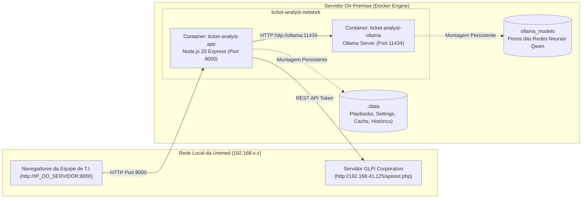

# Guia de Implantação On-Premise — GLPI Ticket Analyst & LLM Local (Docker & Docker Compose)

Este documento detalha o procedimento oficial para hospedar o **GLPI Ticket Analyst** e o motor de Inteligência Artificial Local (**Ollama**) em um servidor dedicado na infraestrutura local da **Unimed Sudoeste de Minas / Hospital Unimed**.

---

## 1. Visão Geral da Arquitetura

A implantação utiliza **Docker** e **Docker Compose** para isolar, padronizar e manter em execução contínua (24/7) dois serviços interdependentes conectados em uma rede interna do Docker (`ticket-analyst-network`):



### Vantagens Desta Arquitetura:
- **Segurança e Privacidade Absoluta:** 100% dos dados dos chamados, relatos médicos e documentos hospitalares trafegam exclusivamente na rede local e são inferidos localmente.
- **Independência de Estações de Trabalho:** O serviço roda de forma autônoma como daemon do sistema operacional, sem depender de sessões de usuário abertas.
- **Inicialização Automática com o Sistema:** Os containers sobem automaticamente no boot do servidor (`restart: unless-stopped`).
- **Persistência Total:** As configurações, playbooks, feedbacks aprendidos e modelos baixados são persistidos em volumes, resistindo a updates de containers.

---

## 2. Dimensionamento de Hardware

| Componente | Cenário A: CPU Only (Econômico / Recomendado) | Cenário B: Com GPU NVIDIA (Alta Performance) |
| :--- | :--- | :--- |
| **Processador** | 4 a 8 vCPUs (Intel Xeon / Core i5/i7 ou AMD Ryzen) | 4 vCPUs ou superior |
| **Memória RAM** | 16 GB de RAM | 16 GB de RAM |
| **Placa de Vídeo** | Não necessária | NVIDIA 6 GB+ VRAM (GTX 1660 Ti, RTX 3060, RTX 4060, Tesla T4) |
| **Armazenamento** | 50 a 80 GB SSD (NVMe ou SATA) | 50 a 80 GB SSD (NVMe ou SATA) |
| **Tempo de Inferência** | ~1 a 3 segundos por chamado (`qwen2.5:3b`) | Sub-segundo (< 500ms por chamado) |

---

## 3. Passo a Passo de Instalação no Servidor (Linux Ubuntu/Debian)

### Passo 1: Instalar o Docker e Docker Compose
Conecte-se ao servidor via terminal (SSH ou console local) e execute:

```bash
# 1. Atualizar repositórios do sistema
sudo apt update && sudo apt upgrade -y

# 2. Instalar pacotes pré-requisitos
sudo apt install -y ca-certificates curl gnupg lsb-release git

# 3. Adicionar chave GPG oficial do Docker
sudo mkdir -p /etc/apt/keyrings
curl -fsSL https://download.docker.com/linux/ubuntu/gpg | sudo gpg --dearmor -o /etc/apt/keyrings/docker.gpg

# 4. Adicionar repositório oficial do Docker
echo "deb [arch=$(dpkg --print-architecture) signed-by=/etc/apt/keyrings/docker.gpg] https://download.docker.com/linux/ubuntu $(lsb_release -cs) stable" | sudo tee /etc/apt/sources.list.d/docker.list > /dev/null

# 5. Instalar Docker Engine, CLI, Containerd e Docker Compose Plugin
sudo apt update
sudo apt install -y docker-ce docker-ce-cli containerd.io docker-compose-plugin

# 6. Permitir execução do Docker sem sudo para o seu usuário
sudo usermod -aG docker $USER
newgrp docker
```

---

### Passo 2: Clonar o Repositório do Projeto
Recomenda-se clonar em `/opt` ou no diretório de serviços do servidor:

```bash
cd /opt
sudo git clone https://github.com/Douglasha/ticket-analyst.git
sudo chown -R $USER:$USER /opt/ticket-analyst
cd /opt/ticket-analyst
```

---

### Passo 3: Configurar as Variáveis de Ambiente (`.env`)
Copie o template `.env.example` para `.env`:

```bash
cp .env.example .env
nano .env
```

Edite o arquivo com os parâmetros de produção da Unimed:

```ini
PORT=8000
NODE_ENV=production

# Integração GLPI REST API (Hospital Unimed)
GLPI_DEMO_MODE=false
GLPI_API_URL=http://192.168.41.125/apirest.php
GLPI_APP_TOKEN=SEU_APP_TOKEN_GLPI_AQUI
GLPI_USER_TOKEN=SEU_USER_TOKEN_GLPI_AQUI
GLPI_DEFAULT_GROUP=T.I
GLPI_VERIFY_SSL=false

# Conexão com Ollama via Docker Compose (Rede interna)
AI_PROVIDER=ollama
OLLAMA_BASE_URL=http://ollama:11434
OLLAMA_MODEL=qwen2.5:3b
OLLAMA_VISION_MODEL=qwen2.5vl:3b

# Credenciais de Acesso Local ao Dashboard
AUTH_LOCAL_USER=admin
AUTH_LOCAL_PASSWORD=admin123
AUTH_SECRET=ticket-analyst-unimed-secret-key-2026
```

> **Dica:** Para salvar no editor `nano`, pressione `Ctrl + O`, tecle `Enter` e saia com `Ctrl + X`.

---

### Passo 4: Subir os Containers
Execute o build da imagem da aplicação e inicie os containers em segundo plano:

```bash
docker compose up -d --build
```

Verifique o status dos containers:

```bash
docker compose ps
```

Você deverá visualizar os dois serviços ativos com status `Up`:
- `ticket-analyst-ollama` (porta `11434`)
- `ticket-analyst-app` (porta `8000`)

---

### Passo 5: Baixar os Modelos da IA no Container do Ollama
Com o container do Ollama rodando, faça o download dos modelos homologados da Unimed:

```bash
# 1. Modelo de texto principal (Qwen 2.5 3B — balanceado, leve e com excelente raciocínio em português)
docker compose exec ollama ollama pull qwen2.5:3b

# 2. Modelo de visão multimodal (Qwen 2.5-VL 3B — para interpretação de prints de erro e fotos anexadas)
docker compose exec ollama ollama pull qwen2.5vl:3b
```

Para confirmar que os modelos foram instalados com sucesso no volume persistente:

```bash
docker compose exec ollama ollama list
```

---

### Passo 6: Validar o Acesso no Navegador
Abra o navegador em qualquer computador conectado à rede corporativa da Unimed e acesse:

```text
http://IP_DO_SERVIDOR:8000
```

Faça o login inicial com o usuário e senha configurados no `.env` (ex.: `admin` / `admin123`).

---

## 4. Configuração com Placa de Vídeo NVIDIA (Opcional)

Se o servidor possuir uma placa de vídeo NVIDIA:

1. **Instale o driver da NVIDIA e o NVIDIA Container Toolkit:**
   ```bash
   sudo apt install -y nvidia-driver-535 nvidia-container-toolkit
   sudo systemctl restart docker
   ```

2. **Ative a GPU no `docker-compose.yml`:**
   Descomente o bloco `deploy` no serviço `ollama`:
   ```yaml
       deploy:
         resources:
           reservations:
             devices:
               - driver: nvidia
                 count: all
                 capabilities: [gpu]
   ```

3. **Reinicie o container:**
   ```bash
   docker compose up -d
   ```

O Ollama automaticamente alocará as camadas da rede neural na memória de vídeo (VRAM).

---

## 5. Rotina de Backup dos Dados do Copiloto

Todos os dados dinâmicos da aplicação (playbooks customizados, histórico da 2ª camada, preferências de usuários e feedback contínuo) ficam centralizados no diretório `./data` do projeto.

Para automatizar o backup diário via `cron` do Linux:

```bash
sudo crontab -e
```

Adicione a linha abaixo para gerar um arquivo compactado diariamente às 23:00:

```cron
0 23 * * * tar -czf /backup/ticket-analyst-data-$(date +\%F).tar.gz /opt/ticket-analyst/data
```

---

## 6. Comandos Úteis de Operação do Docker

| Ação | Comando |
| :--- | :--- |
| **Ver logs da aplicação em tempo real** | `docker compose logs -f app` |
| **Ver logs da LLM (Ollama) em tempo real** | `docker compose logs -f ollama` |
| **Reiniciar os serviços** | `docker compose restart` |
| **Parar os serviços** | `docker compose stop` |
| **Atualizar a aplicação com o repositório GitHub** | `git pull origin main && docker compose up -d --build` |
| **Verificar consumo de memória e CPU** | `docker stats` |
